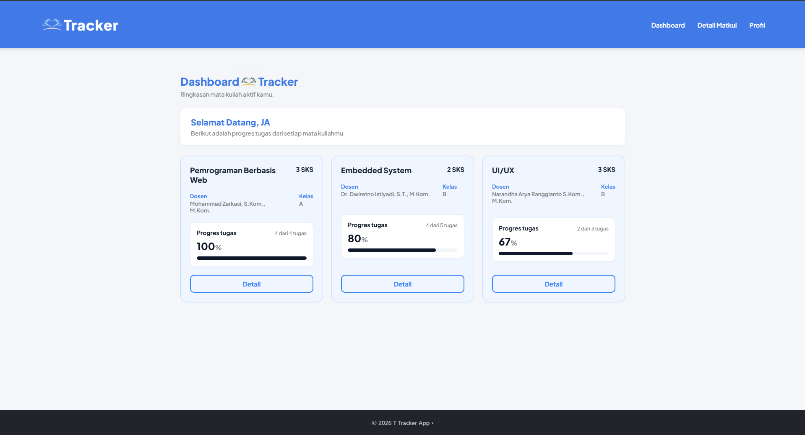
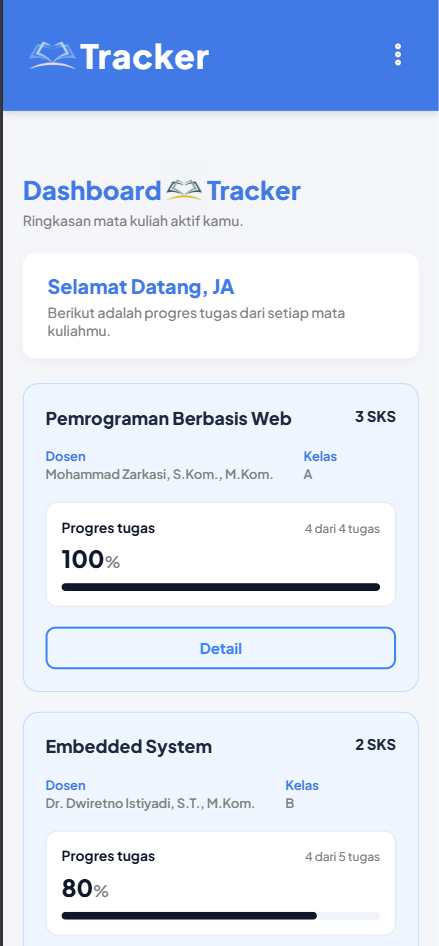

 Task Tracker - Task Management Web App

Task Tracker adalah aplikasi manajemen tugas mahasiswa berbasis web yang dikembangkan menggunakan framework **Laravel**.  
Aplikasi ini menggunakan pola arsitektur **MVC (Model-View-Controller)** dan memanfaatkan **Session Array** sebagai penyimpanan data dinamis sementara, sehingga aplikasi dapat berjalan interaktif **tanpa memerlukan konfigurasi database (MySQL)**.

### Tampilan Desktop

### Tampilan Mobile

---

##  Fitur Utama

- **Authentication Simulation:** Sistem Login dan Log Out (menggunakan form ber-method POST dan perlindungan `@csrf`).
- **Dynamic Progress Tracking:** Dashboard dengan *progress bar* yang otomatis menghitung persentase tugas selesai berdasakan data dari Controller.
- **Responsive Design:** Tampilan antarmuka *Mobile-Friendly* menggunakan Native CSS (Flexbox, Media Queries) dengan fitur navigasi *Hamburger Menu* di layar kecil.
- **Blade Engine Mastery:** Implementasi fitur templating Blade secara komprehensif, mencakup `@extends`, `@section`, `@yield`, `@include`, `@foreach`, `@if`, serta pemanggilan `<x-component>`.

---

##  Teknologi yang Digunakan

- **Backend:** PHP & Framework Laravel
- **Frontend:** HTML5, CSS3 (Native), Blade Templating Engine
- **Font:** Plus Jakarta Sans (Google Fonts)
- **State Management:** Laravel HTTP Session

---

##  Cara Menjalankan Proyek di Lokal (Localhost)

Karena proyek ini **TIDAK menggunakan database**, proses instalasinya sangat mudah dan cepat. Ikuti langkah-langkah berikut:

### 1. Persyaratan Sistem
Pastikan komputer Anda sudah terinstal:
- PHP (minimal versi 8.1+)
- Composer

### 2. Langkah Instalasi
1. Buka terminal (atau Command Prompt / Git Bash) dan arahkan ke folder proyek ini.
2. Jalankan perintah instalasi dependensi Laravel:
   ```bash
   composer install
